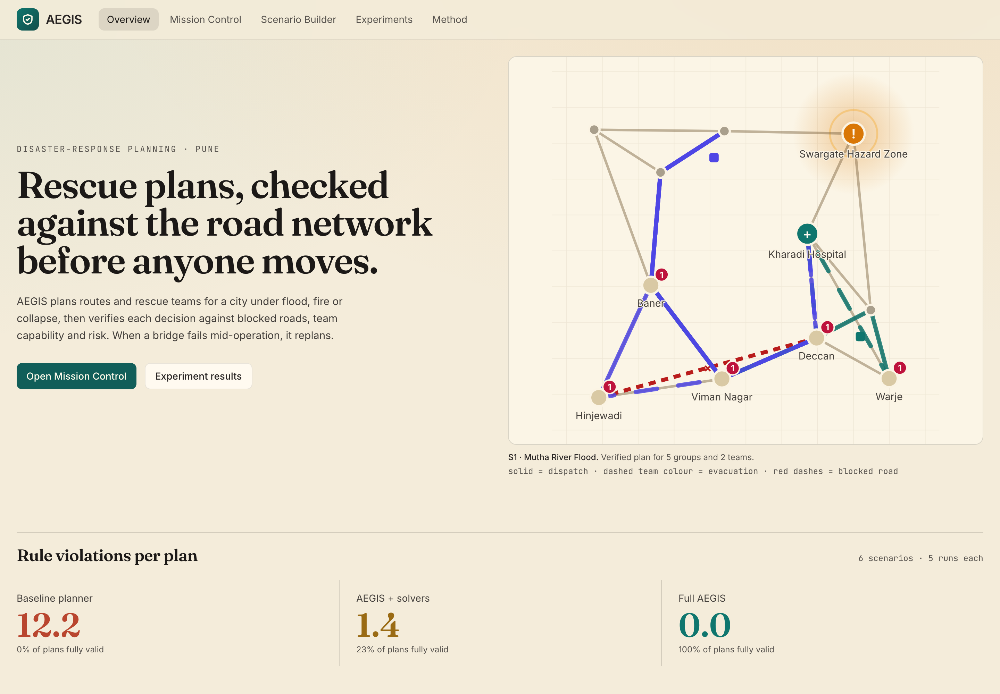
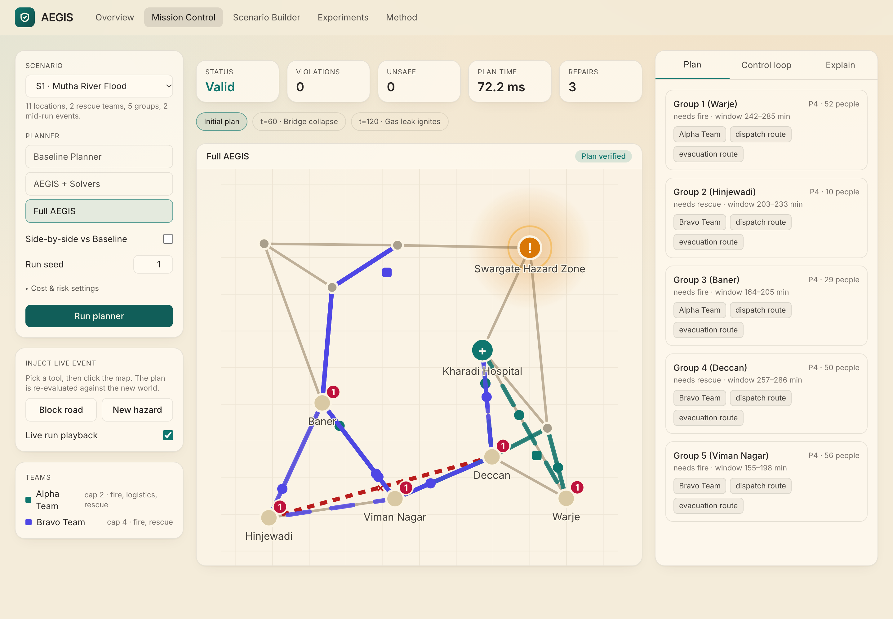
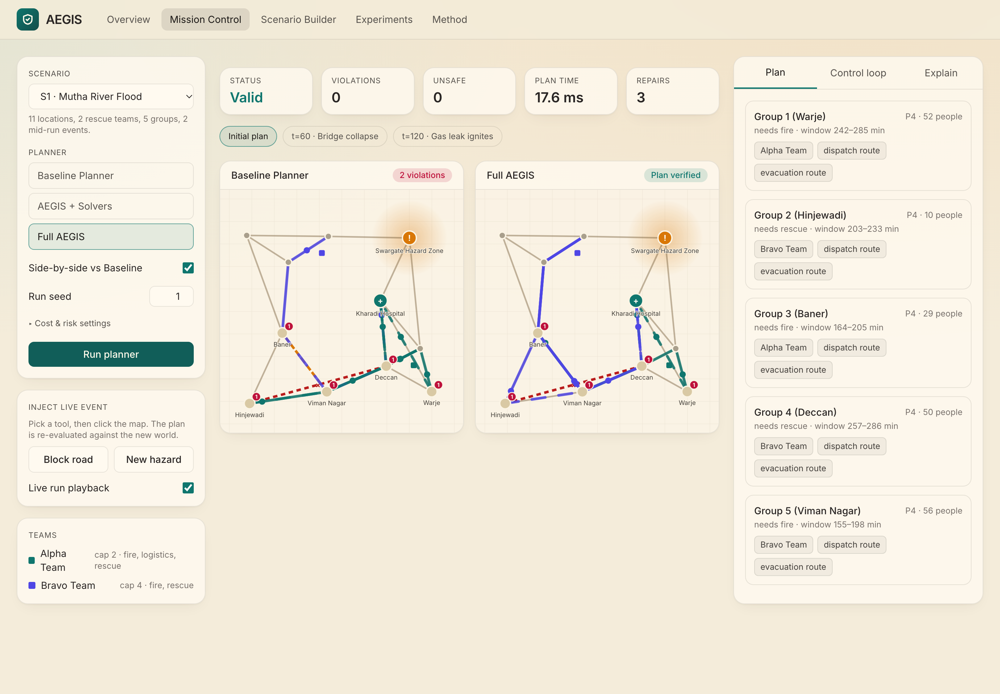
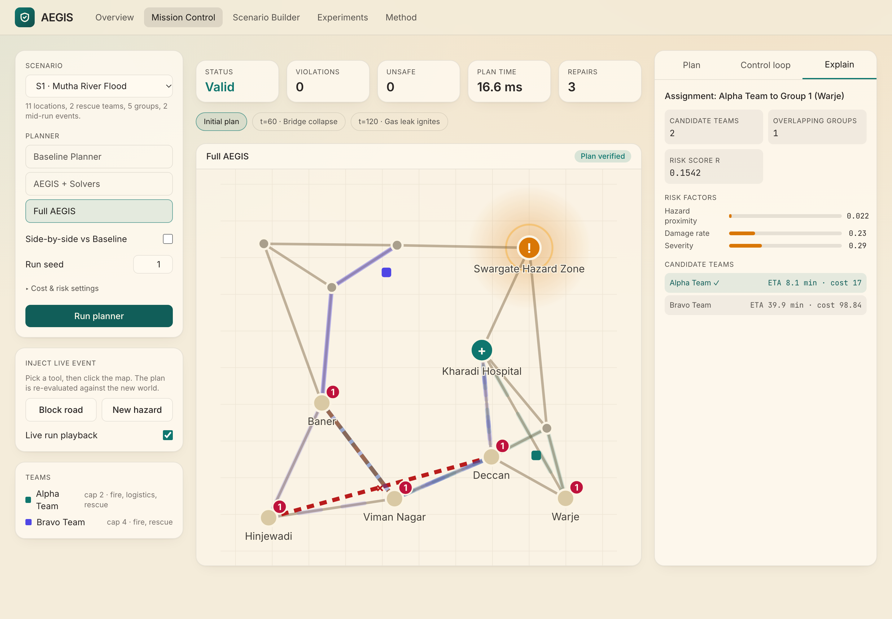
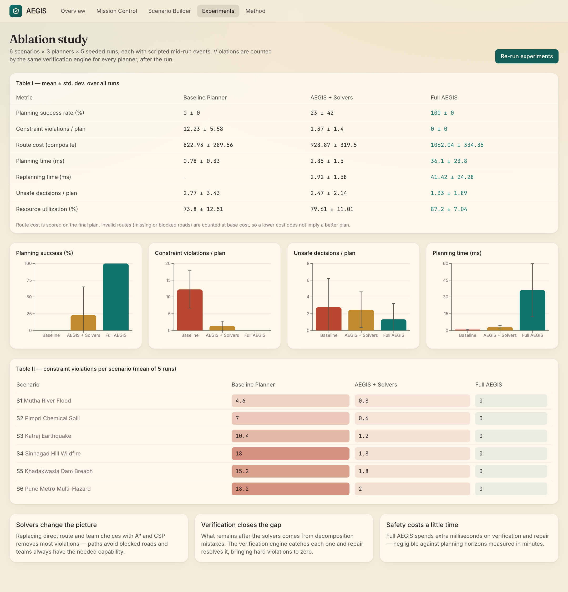
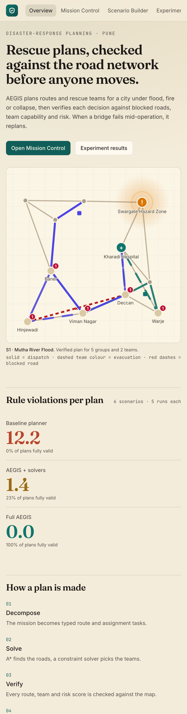
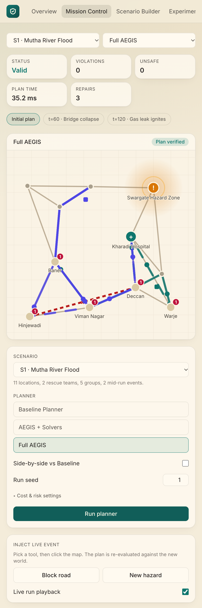

# AEGIS

**Adaptive Explainable Graph-based Intelligence System** for disaster-response planning.

AEGIS plans routes and rescue teams for a city under flood, fire or structural collapse, then checks every decision against the road network, team capabilities and a risk ceiling. When a bridge fails or a new hazard appears mid-operation, it replans.

[](https://github.com/Ishan-Petkar/aegis-planner/actions/workflows/ci.yml)
[](LICENSE)
[](https://colab.research.google.com/github/Ishan-Petkar/aegis-planner/blob/main/notebooks/AEGIS_Colab.ipynb)



## Contents

- [What it does](#what-it-does)
- [Screenshots](#screenshots)
- [Quick start](#quick-start)
- [Manual setup](#manual-setup)
- [Google Colab](#google-colab)
- [How a plan is made](#how-a-plan-is-made)
- [Results](#results)
- [Project layout](#project-layout)
- [API](#api)
- [Tests](#tests)
- [License](#license)

## What it does

- Builds a weighted road graph where every road is open, damaged or blocked.
- Breaks a mission into route and assignment tasks.
- Finds routes with **A\*** using a composite cost of distance, time and risk.
- Assigns teams with a **constraint solver** (capacity, capability, time windows, reachability) using AC-3 pruning and backtracking, and reports a minimal conflict set when no assignment exists.
- Scores risk with a transparent formula, `R = wh·H + wd·D + ws·S`, from hazard proximity, historical damage and area severity.
- **Verifies** every plan and reports each violation with its type, the action and the entity involved.
- **Repairs** failed plans and **replans** when the world changes.
- Explains each decision from solver data: alternatives considered, teams eliminated and why, risk factors.

Six scenarios are set in Pune (Mutha River flood, Pimpri chemical spill, Katraj earthquake, Sinhagad hill wildfire, Khadakwasla dam breach, and a metro-wide multi-hazard). You can also draw your own in the scenario builder.

## Screenshots

**Mission Control** with the plan, route explanations and live event tools:



**Side by side**: the Baseline Planner against Full AEGIS on the same scenario. Violations are drawn in red.



**Explain** any decision: candidate teams with arrival times and costs, and the risk factors behind the score.



**Experiments**: the ablation tables and charts.



**On a phone**

<p>
  
  
</p>

## Quick start

You need **Python 3.9+** and **Node.js 18+**. The launcher checks for them, lists anything missing with install links, installs dependencies on the first run, starts everything and opens your browser.

macOS and Linux:

```bash
git clone https://github.com/Ishan-Petkar/aegis-planner.git
cd aegis-planner
./run.sh
```

Windows: clone the repository, then double-click `run.bat` (or run it from a terminal).

The app opens at http://localhost:5173. Stop it with `./stop.sh` (macOS and Linux) or `stop.bat` (Windows).

See the full [installation guide](docs/INSTALL.md) for prerequisites, custom ports and troubleshooting.

## Manual setup

```bash
# backend (port 8001)
python3 -m venv backend/.venv
backend/.venv/bin/pip install -r backend/requirements.txt
cd backend && ../backend/.venv/bin/python -m uvicorn api:app --port 8001

# web app (port 5173), in a second terminal
cd frontend
npm install
npm run dev
```

On Windows use `backend\.venv\Scripts\python.exe` in place of `backend/.venv/bin/python`.

## Google Colab

[`notebooks/AEGIS_Colab.ipynb`](notebooks/AEGIS_Colab.ipynb) contains the complete model code, the scenario generator, map plots, the control-loop trace and the full experiment. Open it in Colab and choose **Runtime → Run all**. It needs no installs.

## How a plan is made

1. **Decompose**: the mission becomes typed route and assignment tasks.
2. **Solve**: A\* finds the roads and the constraint solver picks the teams.
3. **Score**: every action receives a risk score.
4. **Verify**: the verification engine checks routes, teams, timing, completeness and the risk ceiling.
5. **Repair**: violations feed back into a new plan, up to three iterations.
6. **Execute**: scripted or operator-injected events (a collapsed bridge, a new hazard) trigger a fresh plan.

## Results

Six scenarios, three planners, five seeded runs each. Violations are counted by the same verification engine for every planner.

| Metric | Baseline Planner | AEGIS + Solvers | Full AEGIS |
|---|---|---|---|
| Planning success rate (%) | 0.0 ± 0.0 | 23.0 ± 42.0 | 100.0 ± 0.0 |
| Constraint violations / plan | 12.23 ± 5.58 | 1.37 ± 1.40 | 0.00 ± 0.00 |
| Unsafe decisions / plan | 2.77 ± 3.43 | 2.47 ± 2.14 | 1.33 ± 1.89 |
| Resource utilization (%) | 73.8 ± 12.51 | 79.61 ± 11.01 | 87.2 ± 7.04 |
| Planning time (ms) | 0.54 ± 0.23 | 1.97 ± 1.04 | 25.39 ± 16.81 |
| Replanning time (ms) | – | 2.01 ± 1.07 | 29.47 ± 17.32 |

Timings depend on the machine. All other values are deterministic. Re-run the experiment with `python backend/experiments/run_ablation.py`, which writes `results.json` and `tables.md`.

## Project layout

```
backend/
  aegis/            planning engine (world, A*, CSP, risk, verifier, pipeline, explanations)
  scenarios/        the six Pune scenarios and their generator
  experiments/      ablation runner, results.json, tables.md
  tests/            pytest suite
  api.py            FastAPI service
frontend/           React, Vite, Tailwind web app
notebooks/          Google Colab notebook
docs/               installation guide and screenshots
run.sh, run.bat     one-command launchers
stop.sh, stop.bat   stop scripts
```

## API

| Method | Path | Purpose |
|---|---|---|
| GET | `/api/scenarios` | list scenarios |
| GET | `/api/scenarios/{id}` | one scenario |
| POST | `/api/scenarios` | save a custom scenario |
| POST | `/api/plan` | plan a scenario with a chosen planner |
| POST | `/api/event` | inject a road block, damage or hazard and replan |
| POST | `/api/experiments/run` | run the ablation in the background |
| GET | `/api/experiments/results` | latest results |

Interactive API docs are served at http://localhost:8001/docs while the backend runs.

## Tests

```bash
pip install -r backend/requirements.txt pytest httpx
python -m pytest backend/tests
```

The suite covers A\*, the constraint solver, the verifier, the full pipeline on every scenario, and the API.

## License

MIT. See [LICENSE](LICENSE).
